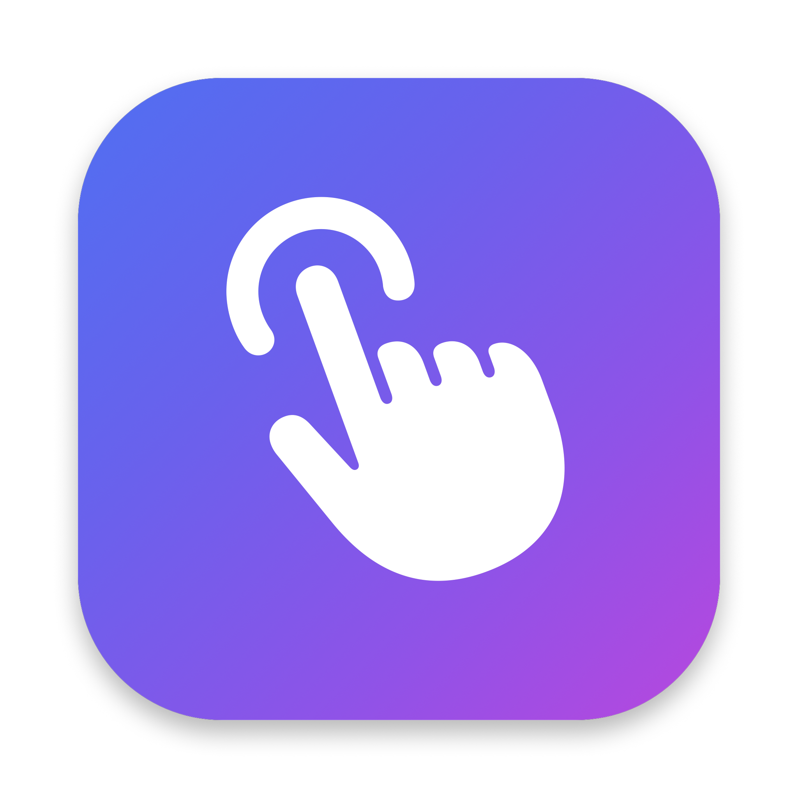
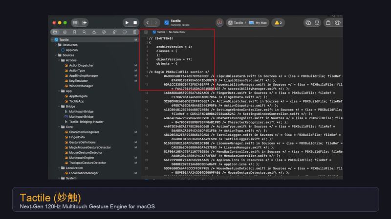
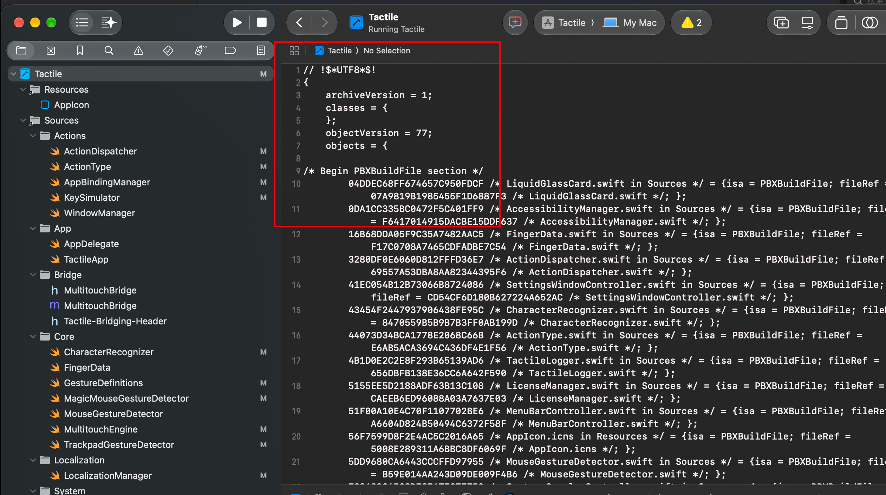
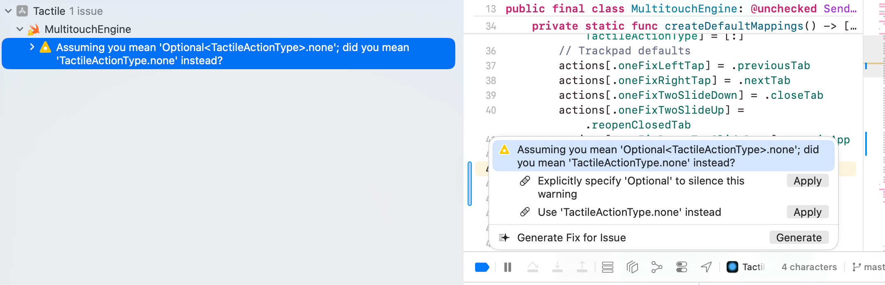
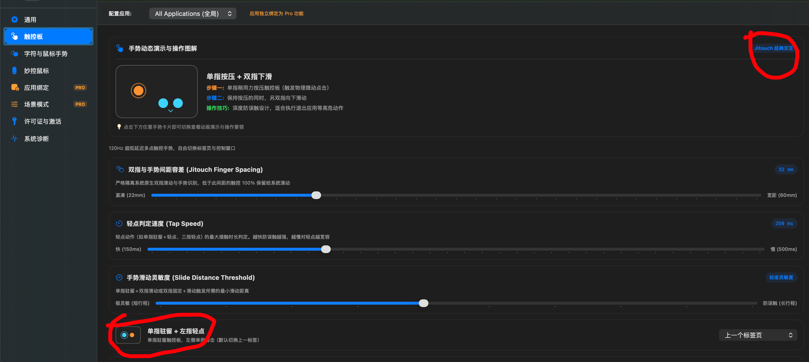
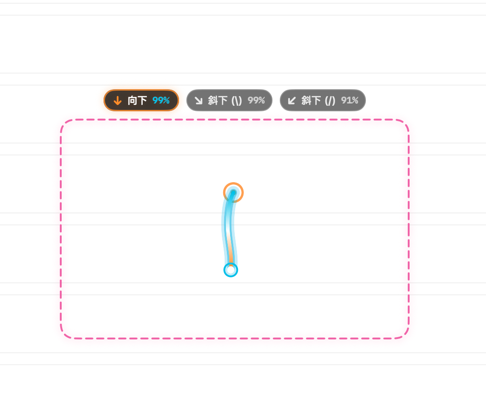
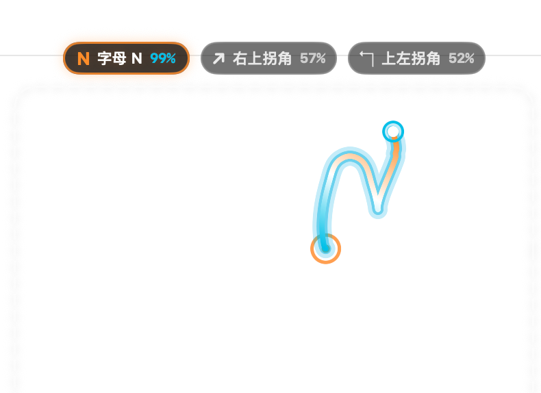

# Tactile (妙触) 🪄

  

  <strong>Next-Generation 120Hz ProMotion Multitouch Gesture Powerhouse & Stroke Drawing Engine for macOS</strong>

  
  
  
  
  

  <strong>English Documentation</strong> | <a href="README_zh.md">中文使用手册</a>

---

## 🎬 Live Demo & Experience

  

> 🎥 **HD Video**: A full high-definition demonstration video is included in [`videos/tactile_demo.mp4`](videos/tactile_demo.mp4).

---

## 📖 Table of Contents

1. [Key Highlights & Performance](#-key-highlights--performance)
2. [Complete Feature Matrix](#-complete-feature-matrix)
3. [Trackpad Gestures In-Depth](#-trackpad-gestures-in-depth)
4. [Character & Stroke Drawing](#-character--stroke-drawing)
5. [Magic Mouse Pro Gestures](#-magic-mouse-pro-gestures)
6. [Power Saving & CPU Optimization](#-power-saving--cpu-optimization)
7. [Scene Presets (Pro)](#-scene-presets-pro)
8. [Per-App Profiles (Pro)](#-per-app-profiles-pro)
9. [Permissions & System Setup](#-permissions--system-setup)
10. [Download & Installation](#-download--installation)
11. [FAQ & Support](#-faq--support)

---

## 🌟 Key Highlights & Performance

- **⚡️ Zero-Alloc Touch Path**: Stack-allocated touch frame buffering inside 120Hz ProMotion callbacks guarantees **zero heap allocations**, keeping memory footprint under 20MB.
- **⏱ Microsecond Latency**: Dispatches directly through macOS driver-level `kCGHIDEventTap`, eliminating the 30–50ms lag common in script-based utilities.
- **🎯 Debounced HID Event Dispatcher**: Single-pipeline HID delivery with hardware debounce (100ms) eliminates duplicate keystroke injection and prevents skipping tabs.
- **✍️ Real-Time Character Drawing & Straightness Filter**: Draw letters (`T`, `W`, `B`, `F`, `Q`, `O`, `S`, `C`, `V`, `Z`, etc.) or directional strokes on your trackpad or via mouse right-drag. An intelligent straightness veto (`straightness >= 0.82`) distinguishes linear diagonal swipes from angular letters like `V` and `W`.
- **🔋 Intelligent Low-Power Mode**: Suspends hardware touch polling when the display sleeps (`screensDidSleepNotification`), instantly resuming on display wake with **0.0% idle CPU**.
- **💨 Settings Window CPU Optimization**: Replaced polling timers with event-driven local monitors and Metal GPU `.drawingGroup()` hardware rendering. Purges all views and timers upon window close.
- **👁 Menubar Stealth Mode**: Option to completely hide the status bar icon for an invisible background footprint; simply click the app in Finder or Launchpad to bring up Settings anytime.
- **🖱 Magic Mouse Pro Suite**: Dedicated surface gesture engine for Magic Mouse 1 & 2 (tab switching, slide close, 3-finger Mission Control, middle-click simulation), fully independent from trackpad settings.
- **🪟 Native Window Tiling**: Window maximize, restore, half-screen snapping, and centering via macOS Accessibility API without requiring heavy third-party daemons.

---

## 📊 Complete Feature Matrix

| Feature | Description | Free Edition | Pro Edition |
| :--- | :--- | :---: | :---: |
| **Trackpad Core Gestures** | One finger rests while another taps left/right (Prev/Next Tab) | ✅ Lifetime Free | ✅ Full Support |
| | One finger rests while another slides up/down (Refresh/Close Tab) | ✅ Lifetime Free | ✅ Full Support |
| | One finger press + two finger slide down (Close Window) | ✅ Lifetime Free | ✅ Full Support |
| | Two fingers rest + index finger double-tap (Middle Click / New Tab) | ✅ Lifetime Free | ✅ Full Support |
| | Three finger tap (Configurable action or system pass-through) | ✅ Lifetime Free | ✅ Full Support |
| | Four finger tap (Lock screen / minimize / custom action) | ✅ Lifetime Free | ✅ Full Support |
| | 3-finger & 4-finger swipe left/right (Space switching / custom action) | ✅ Lifetime Free | ✅ Full Support |
| | Pinky-to-Index wave tap (Maximize window) | ✅ Lifetime Free | ✅ Full Support |
| | Index-to-Pinky wave tap (Minimize window) | ✅ Lifetime Free | ✅ Full Support |
| | Two fingers fixed + one finger slide (Window snapping & tiling) | ✅ Lifetime Free | ✅ Full Support |
| | Tap speed & displacement sensitivity sliders | ✅ Lifetime Free | ✅ Full Support |
| **Character Drawing** | Trackpad single/two-finger drawing & Mouse right-drag drawing | ✅ Lifetime Free | ✅ Full Support |
| | 12 Alphabet gestures (`B, F, T, W, Q, O, S, C, V, Z, L, N`) | ✅ Lifetime Free | ✅ Full Support |
| | 8 Directional strokes (`↑, ↓, ←, →, ↗, ↙, ↖, ↘`) | ✅ Lifetime Free | ✅ Full Support |
| | Live HUD candidate prediction with integer percentage confidence | ✅ Lifetime Free | ✅ Full Support |
| | Dynamic best matching action display beneath HUD | ✅ Lifetime Free | ✅ Full Support |
| | Straightness veto algorithm against diagonal misrecognition | ✅ Lifetime Free | ✅ Full Support |
| | Fluid stroke canvas following cursor with dashed boundary | ✅ Lifetime Free | ✅ Full Support |
| **Magic Mouse Pro** | Independent Magic Mouse switch & Pro license gating | 🔒 Pro Feature | ✅ Full Support |
| | Middle finger fixed + index finger near/far tap (Tab cycling) | 🔒 Pro Feature | ✅ Full Support |
| | Middle finger fixed + index finger slide in/out (Close/Refresh) | 🔒 Pro Feature | ✅ Full Support |
| | Surface 3-finger swipe up/down (Mission Control / Desktop) | 🔒 Pro Feature | ✅ Full Support |
| | Surface center tap middle click simulation | 🔒 Pro Feature | ✅ Full Support |
| **Scene Presets** | 4 Built-in Scene Presets (Daily, Office, Development, Media) | 🔒 View Only | ✅ 1-Click Activation |
| | Save current configuration as custom scene snapshot | 🔒 Pro Feature | ✅ Unlimited Scenes |
| | Instant scene switching via menu bar | 🔒 Pro Feature | ✅ 1-Click Activation |
| | Factory reset to default scene profiles | 🔒 Pro Feature | ✅ Full Support |
| **Per-App Profiles** | Custom gesture overrides for Safari, Chrome, Xcode, VS Code, etc. | 🔒 Pro Feature | ✅ Unlimited Apps |
| | Pick any application from `/Applications` or custom script | 🔒 Pro Feature | ✅ Full Support |
| | Millisecond frontmost app activation hot-reload | 🔒 Pro Feature | ✅ Full Support |
| **Visual & Action Feedback** | Independent toggles for general trackpad HUD vs. drawing HUD | ✅ Lifetime Free | ✅ Full Support |
| | Fluid gesture halo glow animation | ✅ Lifetime Free | ✅ Full Support |
| | HUD toast position customizer (4 screen anchors) | ✅ Lifetime Free | ✅ Full Support |
| **Power & Resource Saving** | Automatic touch suspension on display sleep (Low-Power Mode) | ✅ Lifetime Free | ✅ Full Support |
| | Auto exit settings to silent background mode on launch | ✅ Lifetime Free | ✅ Full Support |
| | Hide menu bar icon for complete stealth background operation | ✅ Lifetime Free | ✅ Full Support |

---

## 🖐 Trackpad Gestures In-Depth

  

### 1. One-Fix Tap
- **One Fix Left Tap**: Place index finger stationary, tap middle finger on the left: **Previous Tab (`Cmd+Shift+[` )**.
- **One Fix Right Tap**: Place index finger stationary, tap middle finger on the right: **Next Tab (`Cmd+Shift+]` )**.

### 2. One-Fix Slide
- **One Fix Two Slide Up**: One finger rests, another slides up: **Refresh Page (`Cmd+R` )**.
- **One Fix Two Slide Down**: One finger rests, another slides down: **Close Tab (`Cmd+W` )**.
- **One Fix Slide Left/Right**: History Back / Forward.

### 3. Multi-Finger Swipes & Taps
- **Three Finger Tap**: Default set to none to preserve macOS dictionary lookup; fully rebindable to Close Tab, Middle Click, or any keystroke.
- **Four Finger Tap**: Simultaneous 4-finger tap for instant Screen Lock or Minimize.
- **Three / Four Finger Swipe Left & Right**: Fluid swipes for application or workspace switching.

---

## ✍️ Character & Stroke Drawing

  

- **Two-Finger / Single-Finger Trackpad Drawing**: Draw letters directly on your trackpad.
- **Mouse Right-Button Gesture**: Option to hold a keyboard modifier (Option, Command, Shift) or **no modifier key at all**. Right-drag and release to trigger.
- **Live Integer HUD**: Displays clean integer percentages (`92%`, `78%`) alongside predicted action titles.
- **Straightness Veto**: Linearity ratio threshold (`straightness >= 0.82`) reliably intercepts angular letter mismatches when performing linear diagonal swipes.

---

## 🖱 Magic Mouse Pro Gestures

  

- **Middle Finger Fixed + Index Tap**: Near tap switches to previous tab; far tap switches to next tab.
- **Middle Finger Fixed + Index Slide**: Slide out refreshes page; slide in closes tab.
- **3-Finger Surface Swipe**: Swipe up for Mission Control; swipe down for Show Desktop.
- **Surface Center Tap**: Simulates native middle-click to open links in background tabs.

---

## 🔋 Power Saving & CPU Optimization

  

- **Screen Sleep Suspension**: Hooks into `NSWorkspace.screensDidSleepNotification` to put driver polling loops to sleep when displays power off, awakening instantaneously upon wake.
- **Zero Idle CPU in Settings**: Replaced 0.15s polling timers with native event monitors (`NSEvent.addLocalMonitorForEvents`).
- **Metal Hardware Acceleration**: Complex gesture demonstrations render via Metal `.drawingGroup()` at 120 FPS without consuming main-thread CPU.
- **Clean Window Destruction**: Closing the settings window completely unloads `NSHostingView` and underlying view models.
- **Menubar Stealth**: Hide status bar icon from macOS menu bar; re-launching from Applications / Launchpad reveals preferences on demand.

---

## 🎛 Scene Presets (Pro)

  

1. **Daily General**: Tailored for Safari, browser navigation, tab cycling, and daily window arrangements.
2. **Office Productivity**: Optimised for Pages, Word, Numbers, and mail workflow with rapid half-screen snapping and text shortcuts.
3. **Software Development**: Deeply tuned for Xcode, VS Code, and Terminal with compile shortcuts, undo/redo, and Mission Control.
4. **Media & Entertainment**: Instant full-screen toggling, volume adjustments, and video playback manipulation.

---

## 📦 Download & Installation

Precompiled and verified binaries are available on [GitHub Releases](https://github.com/jorchford/tactile/releases) and [Tactile Official Site](https://redsite.cn/apps/tactile):

| Architecture / File | Format | Compatibility |
| :--- | :--- | :--- |
| **Tactile-Universal.zip** | Universal 2 Binary (Recommended) | All Apple Silicon (M1-M4) & Intel Macs |
| **Tactile-AppleSilicon.zip** | Native arm64 Build | MacBook Air/Pro, Mac mini, Mac Studio (M-Series) |
| **Tactile-Intel.zip** | Native x86_64 Build | 2015–2020 Intel-based Macs |

### Setup Guide
1. Download the appropriate zip file for your Mac.
2. Unzip and drag `Tactile.app` to your `/Applications` folder.
3. Launch Tactile and grant **Accessibility** permission when prompted.

---

## 💡 FAQ & Support

- **Q: Where is the menubar icon?**  
  A: If "Hide Menu Bar Icon" is enabled, Tactile runs silently in the background. Simply double-click Tactile in Launchpad or Finder to bring up Settings.
- **Q: Is offline activation supported?**  
  A: Yes! Pro licenses use HMAC-SHA256 offline machine UUID validation. No internet connection is required.

---

  Crafted with ❤️ for Mac Power Users. Elevate your gestures with Tactile.

